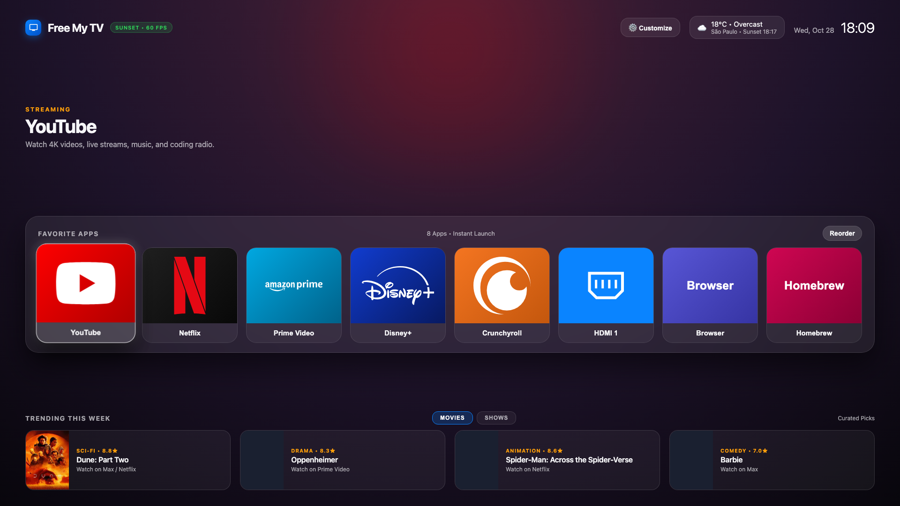
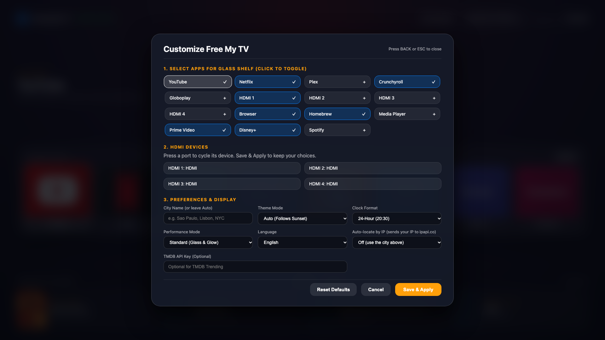
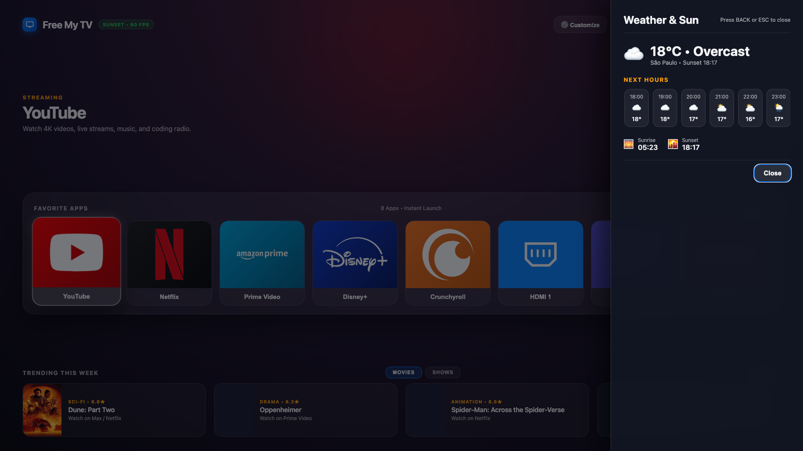

<div align="center">


# Free My TV (for LG webOS)

**A fast, ad-free 60fps home screen for LG Smart TVs.**

The streaming apps you actually use on a frosted glass shelf, live weather that follows the sunset, and trending cinema picks.<br>
Open source. Zero ads. 100% Onboard. No root required.

[](LICENSE)
[](#)
[](#)
[](#)

[**Install**](#-quick-install-2-minutes) · [**Features**](#-what-you-get) · [**Settings**](#%EF%B8%8F-make-it-yours-on-tv-settings) · [**Roadmap**](ROADMAP.md) · [**How It Works**](#%EF%B8%8F-how-it-works)

**🇺🇸 English** · [**🇧🇷 Português**](#free-my-tv-para-lg-webos)

<br>



</div>


<details>
<summary><b>More screenshots</b> (rendered from the app in a desktop browser at 1920×1080)</summary>
<br>



</details>

---

## ⚡ Why This Exists

Modern LG webOS (especially webOS 6, 22, 23, and 24) replaced the classic, snappy bottom card bar with a sluggish full-screen portal packed with:
- Auto-playing banner ads, shopping promotions, and "Trending Now" bloatware.
- 3 to 5 second lag spikes every time you press the Home button.
- Background telemetry and Automatic Content Recognition (ACR).

**Free My TV for webOS** brings the philosophy of [simbasjungles/free-my-tv](https://github.com/simbasjungles/free-my-tv) and Apple tvOS natively to LG televisions—giving you an instantaneous, clean glass dashboard that lives right on your TV's internal flash memory.

---

## ✨ What You Get

- **🚫 Zero Ads. Ever.** No sponsored rows, no banner promos, no shopping widgets.
- **🧊 Frosted Glass App Shelf.** Your favorite streaming apps and HDMI inputs front-and-center, launching natively in ~100ms via the webOS Luna bus.
- **⚙️ Calm On-Screen Settings.** Automatically detects installed apps on your LG TV so you can choose which ones appear on Home, and arrange them by holding OK on any tile. Settings come in four short groups.
- **🌅 Dynamic Sunset & OLED Themes.** Connects to Open-Meteo to show live local weather and automatically shifts your background from *Daylight Blue* to *Sunset Amber* to *Deep Midnight* (plus a *Pure OLED Black* mode).
- **🎬 Movies & Shows Trending Tabs.** Separate tabs for trending movies and TV shows—TMDB-ranked with your optional key, or our built-in zero-key live feed (TVMaze for Shows, curated picks for Movies).
- **🌤️ Weather & Sun Drawer.** Click the weather widget for an hourly forecast and exact sunrise/sunset times, powered by Open-Meteo.
- **🌍 Multi-Language.** English, Português (Brasil), Español, Deutsch and Français, following your TV's language or picked in Settings → You and this TV → Language.
- **🌑 OLED-Safe Idle Screensaver.** After the idle time you choose (1 to 30 minutes), a dimmed, slowly moving [Unsplash](https://unsplash.com) night-sky, aurora and landscape photo fades in behind a floating clock that shifts position to avoid burn-in. Without photos it is a calm, centered clock on a near-black background. Dismissed by any key or remote movement.
- **🎮 Full Magic Remote & D-Pad Support.** Point and click with the LG Magic Remote cursor, or fly across tiles with the directional arrow keys and scroll wheel.
- **💻 100% Onboard & Independent.** Installed as a native `.ipk` package on your TV. Your computer does **not** need to stay on.
- **🛡️ Safe & Reversible.** Works on stock unrooted TVs via official LG Developer Mode (or Homebrew Channel). Your factory home screen is untouched.

---

## 🆕 What's New in 1.6.0

A calmer Free My TV: less text, fewer things on screen at once, and nothing taken away. Every 1.5.0 setting, person, key and shelf choice carries over when you update.

- **🏠 A Quieter Home.** One headline ("Good evening, Noa") instead of several lines of text, big logo tiles for your apps, and the weather, city and sunset time in the top-right corner next to the clock. Scenes and the trending row sit quietly underneath.
- **▶️ Pick-up Is Part of the App Row.** With *Continue where you left off* on, Home opens with focus on the app you opened most recently ("Netflix, opened at 21:10"). Up to two recent apps that are not on your shelf appear as extra tiles at the start of the row, before a thin divider. They are never saved to your shelf.
- **✋ Arrange Apps by Holding OK.** Hold OK on any Home tile for about half a second, then use Left/Right to move it, Down to remove it and OK (or Back) to finish. Every move is saved at once. The same thing is at **Settings → Home → Apps on Home → Arrange on Home**. Kids profiles can move apps but not remove them. The old Reorder button is gone.
- **⚙️ Settings in Four Groups.** **Home**, **Look**, **Screensaver** and **You and this TV**, each with a few rows, on/off switches, and a **More options** page for the rarely changed ones. People and HDMI names have their own sub-pages. This replaces the seven-category Customize screen, and the Customize button on Home is now a gear icon.
- **🪄 Three-Step Setup.** *Hi. What should we call you?* (name and city), *Pick your apps*, and *How should it look?* (with a switch for screensaver photos). The welcome and finish screens are gone; **Skip setup** is always there.
- **👤 A Round People Picker.** "Who is watching?" shows equal round avatars with one clear ring on the selected person and an **Add person** circle at the end (hidden in Kids profiles).
- **🌙 A Calm Screensaver Without Photos.** With no Unsplash key (or photos off) the screensaver is a large, centered, softly dimmed clock with the date and weather, on a near-black background. It still moves slowly for OLED care, and it follows your clock position and night dimming. A short hint to add photos shows once per run, only when no key is set.
- **🧭 A Few Changes to Know About.** The LG TV settings shortcut moved to **Settings → You and this TV → More options**. Shelf tiles now launch when you release OK (so a long press can arrange instead). The Reorder, Cancel and Done buttons on the shelf were replaced by the hold-OK flow above.

Nothing new is sent over the network: the same services as before are contacted, in the same situations (see [Network Requests](#-network-requests-this-app-makes)).

---

## 🆕 What's New in 1.5.0

- **👋 A Greeting by Name.** The home screen greets you by name ("Good evening, Noa") with the weather and sunset time underneath.
- **▶️ Pick Up Where You Left Off.** A compact row above the shelf with the apps you opened last, ordered by the time of day you usually open them.
- **🎬 Scenes.** One-press Movie night, Game on and Background music chips. They open apps and change the look of Free My TV only; they do not control the TV's picture or sound settings.
- **🪄 First-Run Setup.** A short wizard on a fresh install (name and city, apps, look, screensaver photos). Every step can be skipped and **Run setup again** is in Settings (1.6.0 trimmed it to three steps).
- **👨‍👩‍👧 People & Kids Lock.** Profiles for a shared TV, each with its own name, city, shelf and look. A Kids profile hides Settings.
- **🌙 Night Dimming.** The photo screensaver gets dimmer after sunset and much dimmer after 23:00. Turn it off with **Dim Photos at Night**.
- **⚪ One White Focus Ring.** Everything you can select, on Home and in Settings, shows the same clear white ring.
- **🔒 An Honest Privacy Line.** "No ads. No account. Your settings stay on this TV." See [Network Requests](#-network-requests-this-app-makes) for the services the app does contact.
- **🗂️ Reorganised Customize.** Seven categories, plus **Reset settings** and **Erase everything on this TV** (regrouped into four groups in 1.6.0).

---

## 📊 Stock LG webOS Home vs. Free My TV

| Metric / Feature | Stock LG webOS 24 Home | Free My TV (webOS) |
|---|---|---|
| **Sponsored Ads & Banners** | ❌ 70%+ of screen real estate | ✅ **0% (Completely Ad-Free)** |
| **Cold Load Time** | ❌ 3.5 – 5.0 seconds | ✅ **< 0.2 seconds** |
| **Frame Rate** | ❌ Frequent UI frame drops | ✅ **Locked 60 FPS** |
| **OLED Burn-in Friendly** | ❌ Bright static ad banners | ✅ **Dark Glass & Pure OLED Mode** |
| **PC Required After Install** | N/A | ✅ **No (Runs 100% Onboard)** |
| **Root Required** | N/A | ✅ **No (Official Dev Mode)** |

---

## 🚀 Quick Install (2 Minutes)

All you need is an LG Smart TV (webOS 3.0+) and a computer or Android phone on the same Wi-Fi for the initial 2-minute install.

### Step 1: Enable Developer Mode on the TV
1. Open the **Apps / LG Content Store** on your TV, search for **`Developer Mode`**, and install it.
2. Open **Developer Mode**, sign in with your free LG Developer account ([webostv.developer.lge.com](https://webostv.developer.lge.com)), and switch **Dev Mode Status** to **ON**.
3. After the TV restarts, open **Developer Mode** again and toggle **Key Server** to **ON**. Note the **IP Address** and 6-character **Passphrase** on screen.

> [!NOTE]
> While **Key Server** is ON, anyone on your Wi-Fi who knows the passphrase can fetch the TV's SSH key. Turn it **OFF** (and Dev Mode too, if you like) once the install finishes. The installer records the TV's SSH host key on first use (`~/.ssh/webos_tv_known_hosts`) and asks you to confirm a TV found by network discovery (`-y` skips the question; pass the TV's IP to skip discovery). The passphrase is asked interactively; for scripts use `FMTV_PASSPHRASE` or `--passphrase-stdin` rather than a command-line argument.

### Step 2A: Automated One-Command Install (Recommended)
Run our automated Python installer—it discovers your TV on the network, pairs the SSH key, packages the app, and installs it:

```bash
git clone https://github.com/danielthejoker18/FreeMyTvWebOS.git
cd FreeMyTvWebOS
python scripts/install.py
```

### Step 2B: GUI Install via webOS Dev Manager
1. Install [webOS Dev Manager](https://github.com/webosbrew/dev-manager-desktop/releases) (`winget install webosbrew.webOSDevManager` on Windows).
2. Connect your TV using the IP and Passphrase.
3. Download [`dist/org.webos.freemytv_1.2.5_all.ipk`](dist/org.webos.freemytv_1.2.5_all.ipk) and click **Install .ipk**.

### Step 2C: Install from Android Phone via Termux (No PC Needed)
Don't have a computer? You can install Free My TV directly from an Android phone on the same Wi-Fi:

1. Install **Termux from [F-Droid](https://f-droid.org/packages/com.termux/)** *(do not use the Google Play Store version as it is outdated and unsupported)*.
2. Ensure your phone and LG TV are connected to the **same Wi-Fi network** (not a guest Wi-Fi).
3. Open Termux, install dependencies, and run the installer:

```bash
pkg update -y
pkg install -y git python openssh python-cryptography
git clone https://github.com/danielthejoker18/FreeMyTvWebOS.git
cd FreeMyTvWebOS
python scripts/install.py
```

4. The script discovers your TV on the network. When prompted, enter the 6-character **Passphrase** currently shown in the Developer Mode app on the TV.

> [!NOTE]
> Install `python-cryptography` via `pkg install` as shown above. Running `pip install cryptography` on Termux may fail because it attempts to compile native Rust/C extensions on device.

> [!TIP]
> **Make It Your 1-Second Home Key (Quick Access):**
> While inside **Free My TV** on your TV, **press and hold number `1`** (or hold `0` to open Quick Access) on your Magic Remote and assign **Free My TV** to key **`1`**. Now, holding **`1`** from anywhere on your TV jumps straight into your clean glass hub in half a second!

---

## ⚙️ Make It Yours (On-TV Settings)

Press the **⚙️ gear** in the top-right corner of Home with your remote. Settings is a full-screen page with four groups on the left: **Home**, **Look**, **Screensaver** and **You and this TV**. Pick a group (Up/Down, then Right or OK) and move through its rows with Up/Down. On a switch, OK (or Left/Right) flips it; on a choice, Left/Right changes the value; OK on a text row opens the keyboard. Each group shows a handful of rows, and the rest are under **More options** at the bottom. **People** and **HDMI names** open their own sub-pages. Every change is saved the moment you make it, so there is no Save button, and Back steps out one level at a time. Keys (Unsplash, TMDB) are never shown on screen.

**Arrange your apps.** Hold OK on any app tile on Home for about half a second. The tile lifts: Left/Right move it, Down removes it (there is always at least one app left), and OK or Back finishes and saves. Move right past the last app to reach the dashed **Add app** tile (it appears below 8 apps). The same flow starts from **Settings → Home → Apps on Home → Arrange on Home**. Kids profiles can move apps but not remove them, and cannot add apps. Recent-app tiles (see *Home* below) cannot be moved.

Launch messages use the app or console name and report unavailable apps, failures, or no response after eight seconds. Repeated presses are ignored while a launch is pending; browser previews explain that launching requires an LG TV.

HDMI inputs on Home use the names you give them under **Settings → Home → HDMI names**: Left/Right (or OK) cycles each port through HDMI, PS5, PS4, Xbox, Nintendo Switch, and Gaming PC, and every change is saved at once. These are manual, per-port choices; connected consoles are not automatically detected. The tile keeps launching the same HDMI input.

Home tiles show bundled brand logos for PS5, PS4, Xbox, Nintendo Switch, and the streaming apps in the default catalog (including Netflix). These logos work offline. Other installed apps use icons supplied by webOS when accessible; missing or unreadable icons fall back to a readable app name.

Some newer webOS releases block Developer Mode apps from listing installed apps. On those TVs, a one-time on-screen prompt asks to allow Free My TV; accept it so your installed apps appear in **Apps on Home** and in setup.

### Home

One headline greets you by name and day. Underneath are your apps as logo tiles. With *Continue where you left off* on, focus starts on the app you opened last, captioned like "Netflix, opened at 21:10", and up to two recent apps that are not on your shelf appear as extra tiles before a thin divider. Below are the Scenes chips (dim until focused) and the Trending row. The weather, city, sunset time and clock are in the top-right corner, and the privacy line is small at the bottom-right.

### Settings, group by group

| Group | Row | What It Does |
|---|---|---|
| **Home** | **Apps on Home** | Pick up to 8 favorites from the apps installed on your TV (`listLaunchPoints`), and start **Arrange on Home**. |
| **Home** | **HDMI names** | Name the device on each HDMI input (sub-page; shown when your catalog has HDMI inputs). |
| **Home** | **Continue where you left off** | `On` (default) or `Off`. Focus starts on the app you opened last, and recent apps not on your shelf show as extra tiles, ordered by the time of day you usually open them. |
| **Home** | **Scenes** | `On` (default) or `Off`. Movie night (opens your last-used streaming app, Pure black, home photos off), Game on (opens the first HDMI input you named as a console or PC) and Background music (opens Spotify). Back in Free My TV, the look returns as it was. |
| **Home** | **Trending this week** | `On` (default) or `Off`. Hides the movies and shows row; the row is skipped by the remote and stops fetching. |
| **Look** | **Theme** | `Follows the sun` (Auto), `Midnight`, `Pure black` (OLED) or `Daylight Blue`. |
| **Look** | **Photos on Home** | `Off` (default) or `On`. Shows the same Unsplash photos, slowly moving and dimmed, behind Home, with a small "Photo by NAME on Unsplash" credit. Needs the Unsplash key and a TV with `fetch` (webOS 4 or newer); it pauses while the screensaver is showing. |
| **Look** | **Text size**, **Clock format** | Text size, and `24-Hour (20:30)` or `12-Hour (8:30 PM)`. |
| **Look** | **More options → Performance mode** | `Standard (Glass & Glow)` or `High Performance (60 FPS Boost)` to disable heavy backdrop filters on resource-constrained TVs. |
| **Screensaver** | **Screensaver / Starts after** | `On` or `Off`, and the idle time before it starts: 1, 3, 5, 10 or 30 minutes. Applies to the photo and the calm-clock screensaver. |
| **Screensaver** | **Photos from** | Paste the Access Key of a free [Unsplash developer app](https://unsplash.com/developers) (50 requests per hour). Shows only "Unsplash, connected" or "Not set", never the key. The app makes about 5 calls per refresh, at most every 12 hours, shows "Photo by NAME on Unsplash", and sends one ping per photo shown, at most 30 per hour. Photos need a TV with `fetch` (webOS 4 or newer); without them the calm clock is used. |
| **Screensaver** | **Dimmer at night** | `On` (default) or `Off`. A little dimmer after sunset and much dimmer after 23:00, for photos and the calm clock. |
| **Screensaver** | **More options** | Photo length (30 seconds, 90 seconds or 5 minutes), Motion (`Continuous drift`, `Ken Burns`, `Sliding panels` or `None`), Motion speed (`Slow`, `Normal`, `Fast`), Brightness (`Soft`, `Normal`, `Bright`), Clock position (`Bottom Left` default, `Bottom Right`, `Top Left`, `Top Right`, `Center (drifts slowly)`) and **Keep LG screensaver away** (`On` by default: a tiny hidden muted video plays so LG's own screensaver does not cover ours; it may also stop the TV's own auto-sleep while Free My TV is open, so turn it `Off` if you prefer the TV to sleep normally). |
| **You and this TV** | **Your name**, **City**, **Language** | Name for the greeting; a city (e.g. `São Paulo`, `Lisbon`, `New York`) for live Open-Meteo weather and local sunset times (blank means São Paulo); and the language (English, Português, Español, Deutsch, Français, or follow the TV). |
| **You and this TV** | **People** | Sub-page: *Ask who is watching*, *Switch person*, *Add person* and *Remove this person*. Profiles for a shared TV, each with its own name, city, shelf and look. *Add person* runs the setup for a new person and can mark them as a Kids profile that hides Settings; *Remove this person* asks for a second OK. Profiles are stored only on this TV and are not accounts. The person button at the top of Home appears when there are two or more people. |
| **You and this TV** | **More options** | **Auto-locate by IP** (`Off` default; `On` sends your IP to ipapi.co to find your city), **TMDB key** (a free [TMDB API Key](https://www.themoviedb.org/settings/api) for live weekly trending; leave empty for the built-in zero-key feed), **LG TV settings** (opens LG's own Settings app), **Run setup again**, **Reset settings**, **Erase everything on this TV** and **About** (version). |

*Reset settings* restores every setting, the shelf and the device choices to defaults (people and history stay). *Erase everything on this TV* deletes every person, setting, key and history and starts the first-run setup. Both need a second OK to confirm.

**First-run setup** appears by itself only on a fresh install, in three steps (name and city, apps, look and screensaver photos). Every step can be skipped, and every choice stays editable in Settings. Existing 1.5.0 users do not see it.

---

## 🗺️ Roadmap & Things to Come

See the full [ROADMAP.md](ROADMAP.md) for detailed technical specifications.

- [x] **v1.0 — Core 60fps Glass Engine:** Native Luna app launching, Magic Remote + D-Pad spatial nav, 1-command installer.
- [x] **v1.1 — Live Weather, Sunset Themes & On-TV Customizer:** Open-Meteo integration, TMDB + zero-key live trending feed, and interactive app shelf editor.
- [x] **v1.2 — Reordering, Quick Drawer & Languages:** D-Pad tile reordering, weather drawer, bundled brand icons, and `EN`/`PT-BR`/`ES`/`DE`/`FR` support. Trailer deep-links from TMDB picks; per-service title deep-links are still open.
- [x] **v1.6 — The Calm Redesign:** A quieter Home, Settings in four groups, arranging apps by holding OK, three-step setup, a round people picker and a calm screensaver without photos.
- [ ] **v1.3 — OLED Care Screensaver & Wake-on-LAN 📅:** Built-in pixel-shifting 4K ambient screensaver and automatic Wake-on-LAN packet sender to wake your gaming PC when selecting HDMI.
- [ ] **v1.4 — Official Homebrew Repo & Home Button Hook 🚀:** One-click installation from the `webosbrew.org` on-TV store and optional physical Home button binding for rooted TVs.
- [ ] **v2.0 — Smartphone QR Companion & Smart Home Hub 🌟:** Scan a QR code to configure settings from your phone and trigger Home Assistant lighting webhooks.

---

## 🔒 Network Requests This App Makes

| Service | Purpose | When |
|---|---|---|
| Open-Meteo (`api.open-meteo.com`, `geocoding-api.open-meteo.com`) | Weather, sunrise/sunset, city lookup | Always (uses your city, or São Paulo by default) |
| ipapi.co | Approximate location from your public IP | **Only if enabled** in Settings → You and this TV → More options → *Auto-locate by IP* |
| TVMaze (`api.tvmaze.com`) | Zero-key trending shows | Shows tab without a TMDB key |
| TMDB (`api.themoviedb.org`) | Trending movies/shows | Only with your key. v3 keys only work as a URL query parameter; prefer the v4 token (sent as a header). The key is stored in plain text in the TV's `localStorage`. When you open a trending title, its TMDB title id is also sent to look up the trailer |
| Unsplash (`api.unsplash.com`) | Screensaver and home photos | Only with your key (Settings → Screensaver → Photos from) |
| Poster and photo images (`image.tmdb.org`, TVMaze image hosts, Unsplash's image CDN) | The posters and photos you see | Only while those rows or photos are displayed (the bundled curated movie picks load their posters from `image.tmdb.org`, no key needed) |

In short: the only services contacted are Open-Meteo (weather), TMDB (trending titles, with your key; otherwise TVMaze for shows and bundled curated picks for movies), Unsplash (photos, only with your key), their image hosts, and ipapi.co (optional IP-based city lookup, off by default). Only the city or coordinates and your own API keys are sent, each to its own service. Like on any website, every request exposes your public IP to the server you contact; turning on *Auto-locate by IP* additionally sends a request to ipapi.co, which uses your IP to look up your city. Nothing else is shared and there is no account. That is what the home screen's "No ads. No account. Your settings stay on this TV." line means.

No telemetry, no ads, no other destinations.

---

## 🛠️ How It Works

```
free-my-webos/
├── app/
│   ├── appinfo.json       # webOS package manifest & permissions
│   ├── index.html         # Self-contained 60fps Glass UI, Weather, TMDB & Luna bridge
│   ├── webOSTV.js         # Official LG webOS JavaScript service library
│   └── assets/            # App icons & splash screens
├── dist/
│   └── org.webos.freemytv_1.2.5_all.ipk
├── docs/                  # Live preview & visual assets
└── scripts/
    ├── build.py           # Cross-platform .ipk compiler (ares-package + pure Python fallback)
    └── install.py         # Automated SSDP TV discovery, SSH key pairing & Luna installer
```

- **Zero Framework Bloat:** Written in pure, hardware-accelerated HTML5, CSS3, and vanilla JavaScript. The entire `.ipk` package is under **80 KB**.
- **Direct Luna Bus IPC:** Calls `luna://com.webos.applicationManager/launch` directly from the TV's local web engine (with automatic fallback to `luna://org.webosbrew.hbchannel.service/exec`).

---

## 🤝 Credits & License

- Inspired by [simbasjungles/free-my-tv](https://github.com/simbasjungles/free-my-tv) (for Google TV).
- Built for the [webOS Homebrew](https://webosbrew.org/) and LG TV community.
- Weather data by [Open-Meteo](https://open-meteo.com/) · Movie metadata by [TMDB](https://www.themoviedb.org/) & [TVMaze](https://www.tvmaze.com/).

Released under the [MIT License](LICENSE). Fork it, vibe code it, make your TV yours.

---
---

<div align="center">


# Free My TV (para LG webOS)

**Uma home screen rápida, sem anúncios e a 60fps para Smart TVs LG.**

Os apps de streaming que você realmente usa em uma prateleira de vidro fosco, previsão do tempo ao vivo que acompanha o pôr do sol, e sugestões de filmes e séries em alta.<br>
Código aberto. Zero anúncios. 100% independente na TV. Sem necessidade de root.

[](LICENSE)
[](#)
[](#)
[](#)

[**Instalar**](#-instalação-rápida-2-minutos) · [**Recursos**](#-o-que-você-ganha) · [**Ajustes**](#%EF%B8%8F-deixe-do-seu-jeito-ajustes-na-tv) · [**Roadmap**](ROADMAP.md) · [**Como Funciona**](#%EF%B8%8F-como-funciona)

[**🇺🇸 English**](#free-my-tv-for-lg-webos) · **🇧🇷 Português**

<br>


</div>

---

## ⚡ Por Que Isso Existe

O webOS moderno da LG (especialmente webOS 6, 22, 23 e 24) substituiu a clássica barra de cards rápida por um portal de tela cheia lento e cheio de:
- Banners de anúncios automáticos, promoções de compras e lixo de "Em Alta".
- Travamentos de 3 a 5 segundos toda vez que você aperta o botão Home.
- Telemetria em segundo plano e Reconhecimento Automático de Conteúdo (ACR).

**Free My TV para webOS** traz a filosofia do [simbasjungles/free-my-tv](https://github.com/simbasjungles/free-my-tv) e da Apple tvOS nativamente para as TVs LG — te dando um painel de vidro instantâneo e limpo que roda direto na memória flash interna da sua TV.

---

## ✨ O Que Você Ganha

- **🚫 Zero Anúncios. Nunca.** Sem linhas patrocinadas, sem banners promocionais, sem widgets de compras.
- **🧊 Prateleira de Apps em Vidro Fosco.** Seus apps de streaming e entradas HDMI favoritos em destaque, abrindo nativamente em ~100ms via o barramento Luna do webOS.
- **⚙️ Ajustes Calmos na Tela.** Detecta automaticamente os apps instalados na sua TV LG para você escolher quais aparecem no Início e organizá-los segurando OK em qualquer bloco. Os ajustes ficam em quatro grupos curtos.
- **🌅 Temas Dinâmicos de Pôr do Sol e OLED.** Conecta ao Open-Meteo para mostrar o clima local ao vivo e muda automaticamente o fundo de *Azul Diurno* para *Âmbar do Pôr do Sol* até *Meia-Noite Profunda* (além de um modo *Preto OLED Puro*).
- **🎬 Abas de Filmes e Séries em Alta.** Abas separadas para filmes e séries em alta — ranqueadas pelo TMDB com sua chave opcional, ou nosso feed ao vivo sem chave (TVMaze para séries, curadoria para filmes).
- **🌤️ Gaveta de Clima e Sol.** Clique no widget de clima para ver a previsão hora a hora e os horários exatos de nascer/pôr do sol, via Open-Meteo.
- **🌍 Multi-idioma.** English, Português (Brasil), Español, Deutsch e Français, seguindo o idioma da TV ou escolhido em Ajustes → Você e esta TV → Idioma.
- **🌑 Screensaver Seguro para OLED.** Após o tempo parado que você escolher (1 a 30 minutos), uma foto escura e em movimento lento do [Unsplash](https://unsplash.com) aparece atrás de um relógio flutuante que muda de posição para evitar marcação de imagem. Sem fotos, é um relógio calmo e centralizado sobre um fundo quase preto. Some com qualquer tecla ou movimento do controle.
- **🎮 Suporte Completo ao Magic Remote e D-Pad.** Aponte e clique com o cursor do Magic Remote da LG, ou navegue pelos cards com as setas direcionais e a roda de rolagem.
- **💻 100% Independente na TV.** Instalado como um pacote `.ipk` nativo na sua TV. Seu computador **não** precisa ficar ligado.
- **🛡️ Seguro e Reversível.** Funciona em TVs de fábrica sem root via o Developer Mode oficial da LG (ou Homebrew Channel). Sua home screen de fábrica fica intocada.

---

## 🆕 Novidades da 1.6.0

Um Free My TV mais calmo: menos texto, menos coisas na tela ao mesmo tempo e nada removido. Todos os ajustes, pessoas, chaves e escolhas de prateleira da 1.5.0 continuam ao atualizar.

- **🏠 Um Início Mais Quieto.** Uma só frase de destaque ("Boa noite, Noa") no lugar de várias linhas, blocos grandes com o logo dos apps, e o clima, a cidade e o horário do pôr do sol no canto superior direito, junto do relógio. As Cenas e a linha de tendências ficam discretas embaixo.
- **▶️ Continue de Onde Parou na Linha de Apps.** Com *Continue de onde parou* ligado, o Início abre com o foco no app aberto mais recentemente ("Netflix, aberto às 21:10"). Até dois apps recentes que não estão na prateleira aparecem como blocos extras no início da linha, antes de um divisor fino. Eles nunca são salvos na prateleira.
- **✋ Organize Apps Segurando OK.** Segure OK em qualquer bloco do Início por cerca de meio segundo e use Esquerda/Direita para mover, Baixo para remover e OK (ou Voltar) para concluir. Cada mudança é salva na hora. O mesmo caminho existe em **Ajustes → Início → Apps no Início → Organizar na tela inicial**. Perfis infantis podem mover apps, mas não remover. O botão Reordenar acabou.
- **⚙️ Ajustes em Quatro Grupos.** **Início**, **Visual**, **Protetor de tela** e **Você e esta TV**, cada um com poucas linhas, interruptores de ligar/desligar e uma página **Mais opções** para o que raramente muda. Pessoas e Nomes dos HDMI têm subpáginas próprias. Isso substitui a tela Personalizar de sete categorias, e o botão Personalizar do Início agora é um ícone de engrenagem.
- **🪄 Configuração em Três Passos.** *Oi. Como devemos chamar você?* (nome e cidade), *Escolha seus apps* e *Como deve ficar?* (com um interruptor para as fotos do protetor de tela). As telas de boas-vindas e de fim saíram; **Pular configuração** está sempre disponível.
- **👤 Seletor de Pessoas Redondo.** "Quem está assistindo?" mostra avatares redondos do mesmo tamanho, com um anel claro na pessoa selecionada e um círculo **Adicionar pessoa** no fim (oculto em perfis infantis).
- **🌙 Protetor de Tela Calmo Sem Fotos.** Sem chave do Unsplash (ou com as fotos desligadas), o protetor de tela é um relógio grande, centralizado e suavemente escurecido, com data e clima, sobre um fundo quase preto. Ele continua se movendo devagar para proteger o OLED e respeita a posição do relógio e o escurecimento noturno. Uma dica curta para adicionar fotos aparece uma vez por execução, só quando não há chave.
- **🧭 Mudanças Para Saber.** O atalho Config. da TV LG foi para **Ajustes → Você e esta TV → Mais opções**. Os blocos do Início agora abrem quando você solta o OK (assim o toque longo pode organizar). Os botões Reordenar, Cancelar e Concluir da prateleira foram trocados pelo toque longo em OK acima.

Nada novo é enviado pela rede: os mesmos serviços de antes são contatados, nas mesmas situações (veja as Conexões de Rede abaixo).

---

## 🆕 Novidades da 1.5.0

- **👋 Saudação com o seu nome.** A tela inicial cumprimenta você pelo nome ("Boa noite, Noa") com o clima e o horário do pôr do sol embaixo.
- **▶️ Continue de onde parou.** Uma linha compacta acima da prateleira com os apps que você abriu por último, ordenados pelo horário do dia em que costuma abri-los.
- **🎬 Cenas.** Botões de um toque: Noite de filme, Hora do jogo e Música de fundo. Eles abrem apps e mudam o visual do Free My TV; não controlam imagem ou som da TV.
- **🪄 Configuração inicial.** Um assistente curto em instalação nova (nome e cidade, apps, visual, fotos do protetor de tela). Qualquer passo pode ser pulado e **Repetir a configuração** fica em Ajustes (na 1.6.0 ela ficou com três passos).
- **👨‍👩‍👧 Pessoas e bloqueio infantil.** Perfis para uma TV compartilhada, cada um com nome, cidade, prateleira e visual próprios. Um perfil infantil oculta os Ajustes.
- **🌙 Escurecimento noturno.** A foto do protetor de tela fica mais escura depois do pôr do sol e bem mais escura depois das 23:00. Desligue em **Escurecer Fotos à Noite**.
- **⚪ Um único anel branco de foco.** Tudo o que pode ser selecionado, no Início e nos Ajustes, mostra o mesmo anel branco.
- **🔒 Uma frase de privacidade honesta.** "Sem anúncios. Sem conta. Suas configurações ficam nesta TV." Veja as Conexões de Rede abaixo para os serviços que o app contata.
- **🗂️ Personalizar reorganizado.** Sete categorias, mais **Redefinir configurações** e **Apagar tudo nesta TV** (reagrupadas em quatro grupos na 1.6.0).

---

## 📊 LG webOS de Fábrica vs. Free My TV

| Métrica / Recurso | LG webOS 24 de Fábrica | Free My TV (webOS) |
|---|---|---|
| **Anúncios e Banners Patrocinados** | ❌ Mais de 70% da tela | ✅ **0% (Totalmente Sem Anúncios)** |
| **Tempo de Carregamento Frio** | ❌ 3,5 a 5,0 segundos | ✅ **< 0,2 segundos** |
| **Taxa de Quadros** | ❌ Quedas de frame frequentes | ✅ **60 FPS Travados** |
| **Amigável contra Burn-in de OLED** | ❌ Banners de anúncio estáticos e claros | ✅ **Vidro Escuro e Modo OLED Puro** |
| **PC Necessário Após a Instalação** | N/A | ✅ **Não (Roda 100% na TV)** |
| **Root Necessário** | N/A | ✅ **Não (Dev Mode Oficial)** |

---

## 🚀 Instalação Rápida (2 Minutos)

Tudo que você precisa é de uma Smart TV LG (webOS 3.0+) e um computador ou celular Android na mesma rede Wi-Fi para a instalação inicial de 2 minutos.

### Passo 1: Ativar o Developer Mode na TV
1. Abra a **LG Content Store** na sua TV, procure por **`Developer Mode`** e instale.
2. Abra o **Developer Mode**, entre com sua conta gratuita de desenvolvedor LG ([webostv.developer.lge.com](https://webostv.developer.lge.com)) e mude o **Dev Mode Status** para **ON**.
3. Depois da TV reiniciar, abra o **Developer Mode** de novo e ative o **Key Server**. Anote o **Endereço IP** e a **Senha** de 6 caracteres mostrados na tela.

> [!NOTE]
> Enquanto o **Key Server** estiver ativo, quem estiver no seu Wi-Fi e souber a senha pode baixar a chave SSH da TV. Desative-o assim que a instalação terminar. O instalador registra a chave de host da TV no primeiro uso (`~/.ssh/webos_tv_known_hosts`) e pede confirmação para a TV encontrada na rede (`-y` pula a pergunta). A senha é pedida de forma interativa; em scripts use `FMTV_PASSPHRASE` ou `--passphrase-stdin`, nunca como argumento.

### Passo 2A: Instalação Automática em Um Comando (Recomendado)
Rode nosso instalador Python automatizado — ele descobre sua TV na rede, pareia a chave SSH, empacota o app e instala:

```bash
git clone https://github.com/danielthejoker18/FreeMyTvWebOS.git
cd FreeMyTvWebOS
python scripts/install.py
```

### Passo 2B: Instalação via Interface Gráfica (webOS Dev Manager)
1. Instale o [webOS Dev Manager](https://github.com/webosbrew/dev-manager-desktop/releases) (`winget install webosbrew.webOSDevManager` no Windows).
2. Conecte sua TV usando o IP e a Senha.
3. Baixe o [`dist/org.webos.freemytv_1.2.5_all.ipk`](dist/org.webos.freemytv_1.2.5_all.ipk) e clique em **Install .ipk**.

### Passo 2C: Instalação pelo Celular Android via Termux (Sem PC)
Não tem um computador por perto? Você pode instalar o Free My TV direto pelo seu celular Android na mesma rede Wi-Fi:

1. Instale o **Termux pelo [F-Droid](https://f-droid.org/packages/com.termux/)** *(não use a versão da Google Play Store, pois está descontinuada e sem suporte)*.
2. Garanta que o celular e a TV LG estejam na **mesma rede Wi-Fi** (não use rede de convidados).
3. Abra o Termux, instale as dependências e rode o instalador:

```bash
pkg update -y
pkg install -y git python openssh python-cryptography
git clone https://github.com/danielthejoker18/FreeMyTvWebOS.git
cd FreeMyTvWebOS
python scripts/install.py
```

4. O script encontrará sua TV na rede. Quando solicitado, digite a **Senha (Passphrase)** de 6 caracteres exibida no app Developer Mode da TV.

> [!NOTE]
> Instale o `python-cryptography` via `pkg install` como indicado acima. Executar `pip install cryptography` no Termux pode falhar ao tentar compilar extensões nativas em Rust/C no dispositivo.

> [!TIP]
> **Transforme em Sua Tecla de Acesso Rápido (1 Segundo):**
> Dentro do **Free My TV** na sua TV, **segure o número `1`** (ou segure `0` para abrir o Acesso Rápido) no Magic Remote e atribua o **Free My TV** à tecla **`1`**. Agora, segurar **`1`** de qualquer lugar da TV te leva direto para o seu painel de vidro limpo em meio segundo!

---

## ⚙️ Deixe do Seu Jeito (Ajustes na TV)

Pressione a **⚙️ engrenagem** no canto superior direito do Início com o controle remoto. Os Ajustes são uma página em tela cheia com quatro grupos à esquerda: **Início**, **Visual**, **Protetor de tela** e **Você e esta TV**. Escolha um grupo (Cima/Baixo, depois Direita ou OK) e percorra as linhas com Cima/Baixo. Em um interruptor, OK (ou Esquerda/Direita) alterna; em uma escolha, Esquerda/Direita muda o valor; OK em uma linha de texto abre o teclado. Cada grupo mostra poucas linhas, e o resto fica em **Mais opções**, no fim. **Pessoas** e **Nomes dos HDMI** abrem subpáginas próprias. Cada mudança é salva na hora, por isso não há botão Salvar, e Voltar sai um nível por vez. As chaves (Unsplash, TMDB) nunca aparecem na tela.

**Organize seus apps.** Segure OK em qualquer bloco de app no Início por cerca de meio segundo. O bloco levanta: Esquerda/Direita movem, Baixo remove (sempre sobra pelo menos um app) e OK ou Voltar conclui e salva. Vá para a direita depois do último app para chegar ao bloco tracejado **Adicionar app** (aparece com menos de 8 apps). O mesmo caminho começa em **Ajustes → Início → Apps no Início → Organizar na tela inicial**. Perfis infantis podem mover apps, mas não remover nem adicionar. Os blocos de apps recentes (veja *Início* abaixo) não podem ser movidos.

Cada entrada HDMI usa o nome que você der em **Ajustes → Início → Nomes dos HDMI**: Esquerda/Direita (ou OK) alterna a porta entre HDMI, PS5, PS4, Xbox, Nintendo Switch e Gaming PC, e cada mudança é salva na hora. São escolhas manuais, por porta; consoles conectados não são detectados automaticamente. O bloco continua abrindo a mesma entrada HDMI.

### Início

Uma só frase cumprimenta você pelo nome e pelo dia. Embaixo ficam seus apps como blocos com logo. Com *Continue de onde parou* ligado, o foco começa no app aberto por último, com legenda como "Netflix, aberto às 21:10", e até dois apps recentes fora da prateleira aparecem como blocos extras antes de um divisor fino. Mais abaixo estão as Cenas (esmaecidas até receberem o foco) e a linha de tendências. Clima, cidade, pôr do sol e relógio ficam no canto superior direito, e a frase de privacidade, pequena, no canto inferior direito.

### Ajustes, grupo por grupo

| Grupo | Linha | O Que Faz |
|---|---|---|
| **Início** | **Apps no Início** | Escolha até 8 favoritos entre os apps instalados na TV (`listLaunchPoints`) e inicie **Organizar na tela inicial**. |
| **Início** | **Nomes dos HDMI** | Dê um nome ao aparelho de cada entrada HDMI (subpágina; aparece quando há entradas HDMI no catálogo). |
| **Início** | **Continue de onde parou** | `Ligado` (padrão) ou `Desligado`. O foco começa no app aberto por último, e apps recentes fora da prateleira aparecem como blocos extras, ordenados pelo horário do dia em que você costuma abri-los. |
| **Início** | **Cenas** | `Ligado` (padrão) ou `Desligado`. Noite de filme (abre seu último app de streaming, Preto puro, fotos do Início desligadas), Hora do jogo (abre a primeira entrada HDMI que você nomeou como console ou PC) e Música de fundo (abre o Spotify). Ao voltar ao Free My TV, o visual volta como era. |
| **Início** | **Em alta na semana** | `Ligado` (padrão) ou `Desligado`. Oculta a linha de filmes e séries; ela é ignorada pelo controle e para de buscar dados. |
| **Visual** | **Tema** | `Segue o sol` (Automático), `Meia-noite`, `Preto puro` (OLED) ou `Azul Diurno`. |
| **Visual** | **Fotos no Início** | `Desligado` (padrão) ou `Ligado`. Mostra as mesmas fotos do Unsplash, em movimento lento e escurecidas, atrás do Início, com o crédito "Foto de NOME no Unsplash". Precisa da chave do Unsplash e de uma TV com `fetch` (webOS 4 ou mais novo); pausa enquanto o protetor de tela aparece. |
| **Visual** | **Tamanho do texto**, **Formato do relógio** | Tamanho do texto, e `24 Horas (20:30)` ou `12 Horas (8:30 PM)`. |
| **Visual** | **Mais opções → Modo de desempenho** | `Padrão (Vidro & Brilho)` ou `Alta Performance (60 FPS Boost)` para desativar filtros pesados de desfoque em TVs mais modestas. |
| **Protetor de tela** | **Protetor de tela / Inicia após** | `Ligado` ou `Desligado`, e o tempo parado antes de iniciar: 1, 3, 5, 10 ou 30 minutos. Vale para o protetor com fotos e para o relógio calmo. |
| **Protetor de tela** | **Fotos de** | Cole a chave de acesso de um [app de desenvolvedor gratuito do Unsplash](https://unsplash.com/developers) (50 requisições por hora). Mostra só "Unsplash, conectado" ou "Não definido", nunca a chave. O app faz cerca de 5 chamadas por atualização, no máximo a cada 12 horas, mostra "Foto de NOME no Unsplash" e envia um ping por foto exibida, no máximo 30 por hora. As fotos precisam de uma TV com `fetch` (webOS 4 ou mais novo); sem elas, usa-se o relógio calmo. |
| **Protetor de tela** | **Mais escuro à noite** | `Ligado` (padrão) ou `Desligado`. Um pouco mais escuro depois do pôr do sol e bem mais escuro depois das 23:00, para as fotos e para o relógio calmo. |
| **Protetor de tela** | **Mais opções** | Duração da foto (30 s, 90 s ou 5 min), Movimento (`Deriva contínua`, `Ken Burns`, `Painéis deslizantes` ou `Nenhum`), Velocidade do movimento (`Lenta`, `Normal`, `Rápida`), Brilho (`Suave`, `Normal`, `Brilhante`), Posição do relógio (padrão inferior esquerdo, outro canto, ou centro com deriva lenta) e **Evitar o protetor de tela da LG** (`Ligado` por padrão: um vídeo minúsculo, mudo e invisível toca para que o protetor da própria LG não cubra o nosso; pode impedir também o desligamento automático da TV enquanto o Free My TV está aberto, então desligue se preferir o comportamento normal). |
| **Você e esta TV** | **Seu nome**, **Cidade**, **Idioma** | Nome para a saudação; uma cidade (ex.: `São Paulo`, `Lisboa`, `Nova York`) para clima ao vivo via Open-Meteo e horários locais de pôr do sol (em branco usa São Paulo); e o idioma (English, Português, Español, Deutsch, Français, ou seguir a TV). |
| **Você e esta TV** | **Pessoas** | Subpágina: *Perguntar quem está assistindo*, *Trocar de pessoa*, *Adicionar pessoa* e *Remover esta pessoa*. Perfis para uma TV compartilhada, cada um com nome, cidade, prateleira e visual próprios. *Adicionar pessoa* abre a configuração para uma nova pessoa e pode marcá-la como perfil infantil, que oculta os Ajustes; *Remover esta pessoa* pede um segundo OK. Os perfis ficam guardados só nesta TV e não são contas. O botão da pessoa no alto do Início aparece quando há duas ou mais pessoas. |
| **Você e esta TV** | **Mais opções** | **Localizar por IP** (`Desligado` por padrão; `Ligado` envia seu IP ao ipapi.co para achar sua cidade), **Chave TMDB** (uma [chave gratuita da API do TMDB](https://www.themoviedb.org/settings/api) para tendências semanais ao vivo; em branco usa o feed embutido sem chave), **Config. da TV LG** (abre os Ajustes da própria LG), **Repetir a configuração**, **Redefinir configurações**, **Apagar tudo nesta TV** e **Sobre** (versão). |

*Redefinir configurações* restaura todas as configurações, a prateleira e as escolhas de dispositivo ao padrão (pessoas e histórico ficam). *Apagar tudo nesta TV* apaga todas as pessoas, configurações, chaves e histórico e abre a configuração inicial. Os dois pedem um segundo OK.

A **configuração inicial** aparece sozinha apenas em uma instalação nova, em três passos (nome e cidade, apps, visual e fotos do protetor de tela). Qualquer passo pode ser pulado e tudo continua editável nos Ajustes. Quem já usa a 1.5.0 não a vê.

---

## 🗺️ Roadmap e Próximos Passos

Veja o [ROADMAP.md](ROADMAP.md) completo para as especificações técnicas detalhadas.

- [x] **v1.0 — Motor de Vidro 60fps:** Abertura nativa de apps via Luna, navegação espacial com Magic Remote + D-Pad, instalador em 1 comando.
- [x] **v1.1 — Clima ao Vivo, Temas de Pôr do Sol e Personalizador na TV:** Integração com Open-Meteo, TMDB + feed de tendências sem chave, e editor interativo da prateleira de apps.
- [x] **v1.2 — Reordenação, Gaveta Rápida e Idiomas:** reordenação por D-Pad, gaveta do clima, ícones de marca embutidos e suporte a `EN`/`PT-BR`/`ES`/`DE`/`FR`. Deep-link de trailers do TMDB; deep-links por serviço ainda em aberto.
- [x] **v1.6 — O Redesign Calmo:** Início mais quieto, Ajustes em quatro grupos, apps organizados segurando OK, configuração em três passos, seletor de pessoas redondo e protetor de tela calmo sem fotos.
- [ ] **v1.3 — Proteção de Tela OLED e Wake-on-LAN 📅:** Protetor de tela ambiente 4K com deslocamento de pixels embutido e envio automático de pacotes Wake-on-LAN para acordar seu PC gamer ao selecionar o HDMI.
- [ ] **v1.4 — Repositório Oficial no Homebrew e Atalho do Botão Home 🚀:** Instalação em um clique pela loja na TV do `webosbrew.org` e vínculo opcional do botão físico Home para TVs com root.
- [ ] **v2.0 — Companheiro QR no Celular e Hub Smart Home 🌟:** Escaneie um QR code para configurar pelo celular e disparar webhooks de iluminação do Home Assistant.

---

## 🔒 Conexões de Rede do App

| Serviço | Para quê | Quando |
|---|---|---|
| Open-Meteo (`api.open-meteo.com`, `geocoding-api.open-meteo.com`) | Clima, nascer/pôr do sol e busca da cidade | Sempre (usa sua cidade ou São Paulo por padrão) |
| ipapi.co | Localização aproximada pelo seu IP público | **Só se ativado** em Ajustes → Você e esta TV → Mais opções → *Localizar por IP* |
| TVMaze (`api.tvmaze.com`) | Séries em alta sem chave | Aba Shows sem chave TMDB |
| TMDB (`api.themoviedb.org`) | Filmes/séries em alta | Só com a sua chave. Chaves v3 só funcionam na query string da URL; prefira o token v4 (enviado em cabeçalho). A chave fica em texto simples no `localStorage` da TV. Ao abrir um título em alta, o id TMDB dele também é enviado para buscar o trailer |
| Unsplash (`api.unsplash.com`) | Fotos do protetor de tela e da tela inicial | Só com a sua chave (Ajustes → Protetor de tela → Fotos de) |
| Imagens de pôsteres e fotos (`image.tmdb.org`, servidores de imagem do TVMaze, CDN de imagens do Unsplash) | Os pôsteres e fotos que você vê | Só enquanto essas linhas ou fotos aparecem (as sugestões embutidas de filmes carregam os pôsteres de `image.tmdb.org`, sem chave) |

Resumindo: os únicos serviços contatados são Open-Meteo (clima), TMDB (títulos em alta, com a sua chave; senão TVMaze para séries e sugestões embutidas para filmes), Unsplash (fotos, só com a sua chave), os servidores de imagem desses serviços e ipapi.co (busca opcional da cidade pelo IP, desativada por padrão). Só são enviados a cidade ou as coordenadas, suas próprias chaves de API, cada uma ao seu próprio serviço. Como em qualquer site, toda requisição expõe seu IP público ao servidor contatado; ativar *Localizar por IP* envia ainda uma requisição ao ipapi.co, que usa seu IP para descobrir sua cidade; nada mais é compartilhado e não há conta.

Sem telemetria, sem anúncios, sem outros destinos.

---

## 🛠️ Como Funciona

```
free-my-webos/
├── app/
│   ├── appinfo.json       # Manifesto do pacote webOS e permissões
│   ├── index.html         # UI de vidro 60fps autocontida, clima, TMDB e ponte com o Luna
│   ├── webOSTV.js         # Biblioteca oficial de serviços JavaScript do LG webOS
│   └── assets/            # Ícones e telas de splash do app
├── dist/
│   └── org.webos.freemytv_1.2.5_all.ipk
├── docs/                  # Preview ao vivo e recursos visuais
└── scripts/
    ├── build.py           # Compilador .ipk multiplataforma (ares-package + fallback em Python puro)
    └── install.py         # Descoberta de TV via SSDP, pareamento de chave SSH e instalador via Luna
```

- **Zero Dependência de Frameworks:** Escrito em HTML5, CSS3 e JavaScript puro acelerado por hardware. O pacote `.ipk` inteiro tem menos de **80 KB**.
- **IPC Direto pelo Barramento Luna:** Chama `luna://com.webos.applicationManager/launch` diretamente do motor web local da TV (com fallback automático para `luna://org.webosbrew.hbchannel.service/exec`).

---

## 🤝 Créditos e Licença

- Inspirado por [simbasjungles/free-my-tv](https://github.com/simbasjungles/free-my-tv) (para Google TV).
- Feito para a comunidade [webOS Homebrew](https://webosbrew.org/) e de TVs LG.
- Dados de clima por [Open-Meteo](https://open-meteo.com/) · Metadados de filmes por [TMDB](https://www.themoviedb.org/) & [TVMaze](https://www.tvmaze.com/).

Lançado sob a [Licença MIT](LICENSE). Faça um fork, modifique como quiser, deixe a TV do seu jeito.
