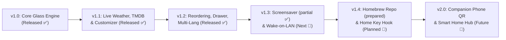

# 🗺️ Free My TV (webOS) — Product Roadmap

Our mission is to provide every LG Smart TV owner (webOS 3.0 through webOS 24+) with an instantaneous, zero-ad, 60fps home screen that respects their hardware and privacy.

---

## 📈 Release Timeline

---

## ✅ Completed Milestones

### v1.0 — The 60fps Frosted Glass Foundation
- [x] Zero-dependency HTML5/CSS3 hardware-accelerated Frosted Glass UI.
- [x] Direct Luna Bus integration (`luna://com.webos.applicationManager/launch`) for ~100ms native app launching.
- [x] Full LG Magic Remote pointer + D-Pad spatial keyboard navigation (`Arrow` keys, `Enter`, and `Back` button `keyCode 461`).
- [x] Automated local network SSDP discovery & one-command Python installer (`scripts/install.py`).
- [x] Standalone pure-Python `.ipk` compiler fallback (`scripts/build.py`).

### v1.1 — Dynamic Live Data & On-TV Personalization
- [x] **On-Screen Shelf Customizer:** Auto-discovers installed apps directly from the TV OS (`listLaunchPoints`) and lets users toggle favorites with the remote.
- [x] **Live Open-Meteo Weather & Sunset Engine:** Auto-detects location (or custom city) and shifts background ambiance between *Daylight Blue*, *Sunset Amber*, *Deep Midnight*, and *Pure OLED Black*.
- [x] **TMDB & Zero-Key Live Trending Row:** Supports personal TMDB API keys with an automatic zero-key live fallback feed for top-rated shows.

---

## 🚧 Upcoming Milestones

### v1.2 — Reordering, Quick Drawer & Localization (Released)
- [x] **YouTube Trailer Deep-Linking *(partial)*:** With a TMDB key, trending cards open the title's YouTube trailer via a `contentTarget` launch parameter (untested on hardware; falls back to launching the app). Deep links into Netflix, Disney+, Prime Video and Plex still need per-service title IDs ([#19](https://github.com/danielthejoker18/FreeMyTvWebOS/issues/19)).
- [x] **D-Pad Reordering:** Reorder app tiles directly on the shelf with the Reorder button and Left/Right arrows.
- [x] **Bundled Brand Icons:** Streaming and console tiles ship minimalist brand logos. *(Extracting the TV's own icons remains open.)*
- [x] **Slide-Out Info Drawer *(landed early)*:** Clicking the weather widget opens a panel with an hourly forecast (6 hours) and sunrise/sunset times, powered by Open-Meteo. Live market/sports scores are not included.
- [x] **Movies / Shows Trending Tabs *(not originally planned, added early)*:** The trending row is now two tabs instead of one mixed list — TMDB-ranked when a key is set, TVMaze's live feed for Shows with no key, curated picks for Movies with no key.
- [x] **Multi-Language Support:** English, Portuguese (`pt-BR`), Spanish, German and French; follows the TV language or the Language setting.

### v1.3 — OLED Care Screensaver & PC Wake-on-LAN
- [x] **Idle Screensaver & Clock Overlay:** An OLED-safe screensaver with a floating clock that pixel-shifts position every ~25s, starting after a configurable idle time (1-30 minutes, default 3). With an Unsplash key it shows dimmed, slowly moving night-sky and landscape photos behind the clock (about 5 API calls per 12-hour refresh plus one download ping per photo shown, at most 30 per hour, inside Unsplash's 50 requests per hour); without one it stays pure black. Photos can also run behind the home screen (setting), and a hidden muted video keeps LG's own screensaver from covering ours (setting).
- [x] **Remote-friendly Customize screen:** categories, one row per setting, an apps page, instant save, visible focus and masked keys.
- [ ] **Wake-on-LAN (WoL) PC Tile:** Turn on your gaming PC or home media server automatically when clicking the HDMI / Plex tile.
- [ ] **System Debloat Helper:** Optional one-click toggle inside Settings to mute LG promotional notifications and clear background app memory. Needs root (Homebrew Channel) — this app runs unrooted, so it cannot touch system services on its own.

### v1.5 — Personal TV (Released)
- [x] **First-run setup wizard:** name, shelf apps, look, city and screensaver photos, all with the remote.
- [x] **People:** several people on one TV, each with their own shelf, look, city and photos; a "Who is watching?" picker and a locked Kids profile that hides Customize.
- [x] **Scenes and pick-up:** one-press scenes that open the app you use at that time of day, and a "Pick up where you left off" row built from what you opened last (kept only on this TV).
- [x] **Night dim:** the home screen softens after sunset.
- [x] **Customize reorganised:** seven categories, with Reset settings and Erase everything on this TV.

### v1.6 — The Calm Redesign (Released)
- [x] **Quieter Home:** one headline, logo tiles, the weather in the top-right corner, and "pick up where you left off" folded into the app row (focus on the last app plus up to two recent tiles).
- [x] **Settings in four groups:** Home, Look, Screensaver and You and this TV, with switches, a More options page, and People and HDMI names sub-pages. Replaces the seven-category Customize screen; no setting removed.
- [x] **Arrange apps by holding OK:** long press on a Home tile (or Settings > Home > Apps on Home > Arrange on Home) to move, remove or add apps; Kids profiles can move but not remove.
- [x] **Three-step setup, round people picker, calm screensaver without photos.** No new network calls.

### v1.4 — Official Homebrew Channel Repo & Home Button Hook
- [ ] **Publish to `webosbrew.org` Repository:** Manifest generation and the package entry are ready in [`homebrew/`](homebrew/README.md); what remains is the PR to `webosbrew/apps-repo`.
- [ ] **Optional Physical Home Button Hijack (Root / Autostart):** For rooted TVs, optionally bind the physical `Home` button on the Magic Remote directly to **Free My TV** instead of `com.webos.app.home`.

### v2.0 — Companion QR Setup & Smart Home Integration
- [ ] **QR Code Phone Companion:** Scan a QR code on the TV screen to type API keys, reorder apps, or push custom URLs from your smartphone browser.
- [ ] **Home Assistant / MQTT Integration:** Optional webhook/status bridge for smart room lighting scenes when launching movies.

---

## 🤝 Contributing

Have an idea or want to tackle an item on the roadmap?
1. Fork the repository.
2. Edit [`app/index.html`](app/index.html) (keep JavaScript ES5: no `const`/`let`/arrow functions/template literals).
3. Run `python scripts/sync_docs.py` (mirrors the app into `docs/`) and `python scripts/check.py`; CI runs the same checks and requires ES5-only JavaScript for webOS 3.x.
4. Submit a Pull Request!
